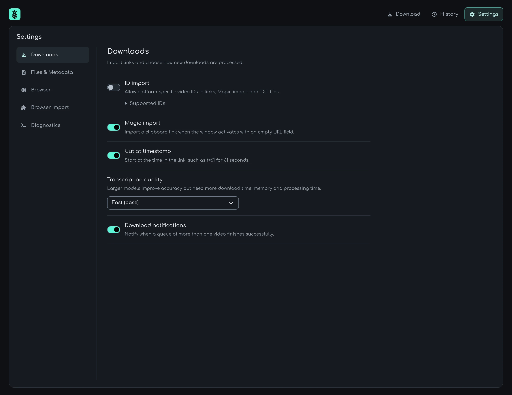
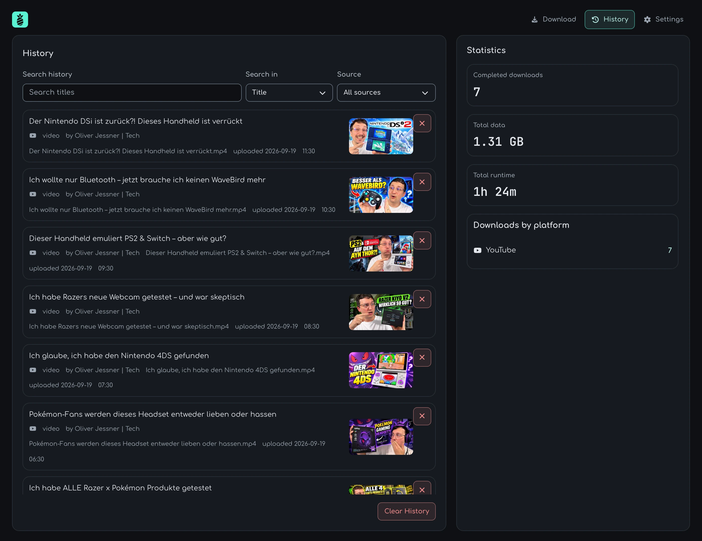
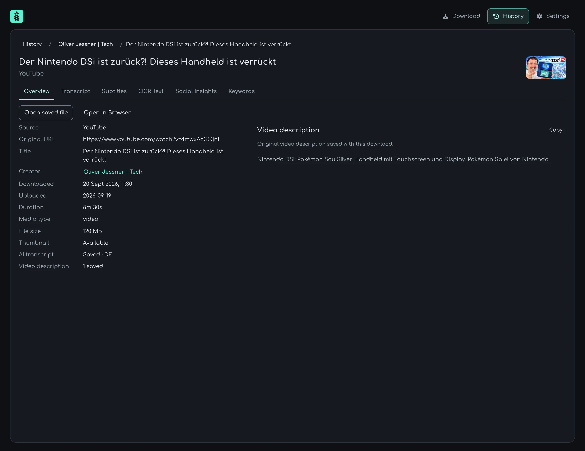
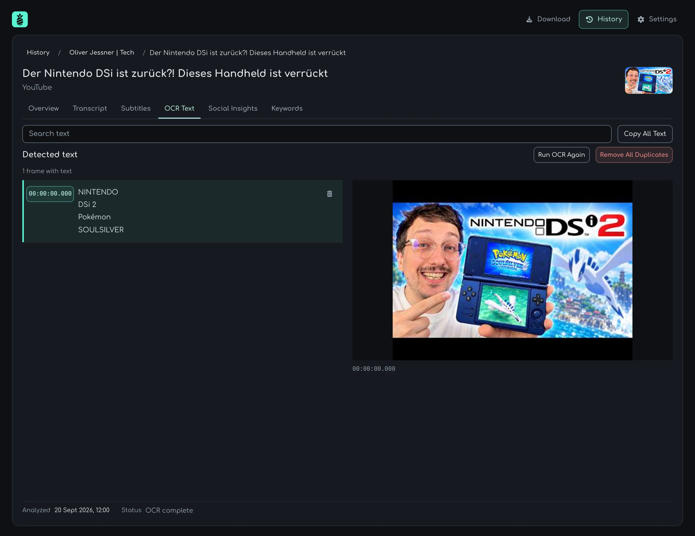
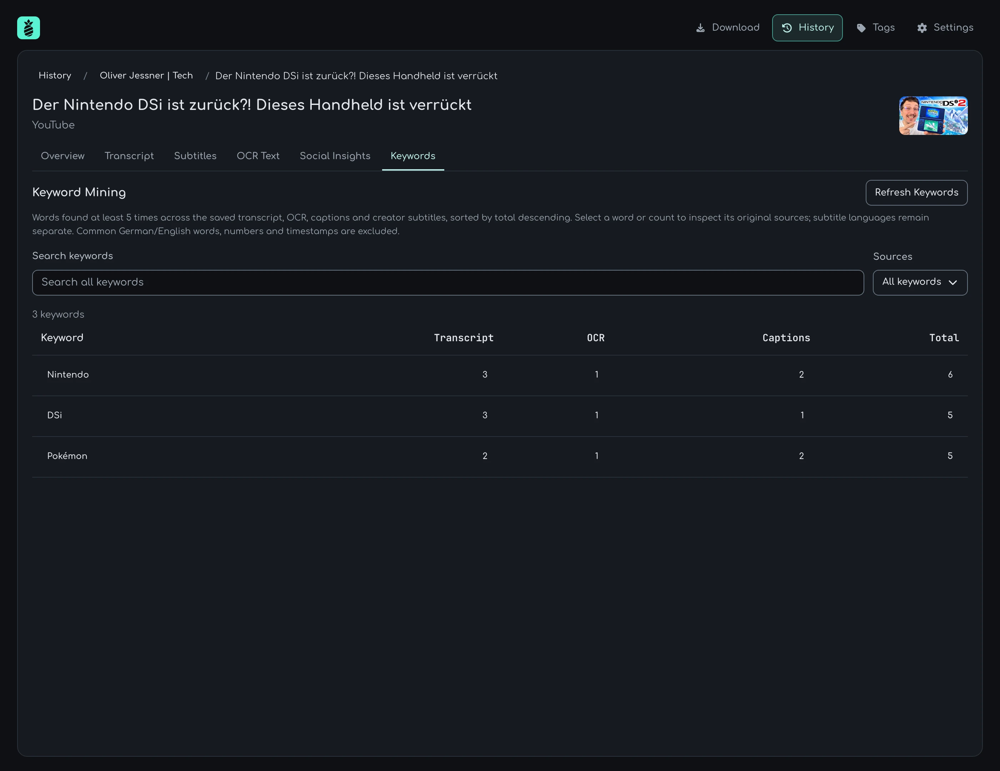
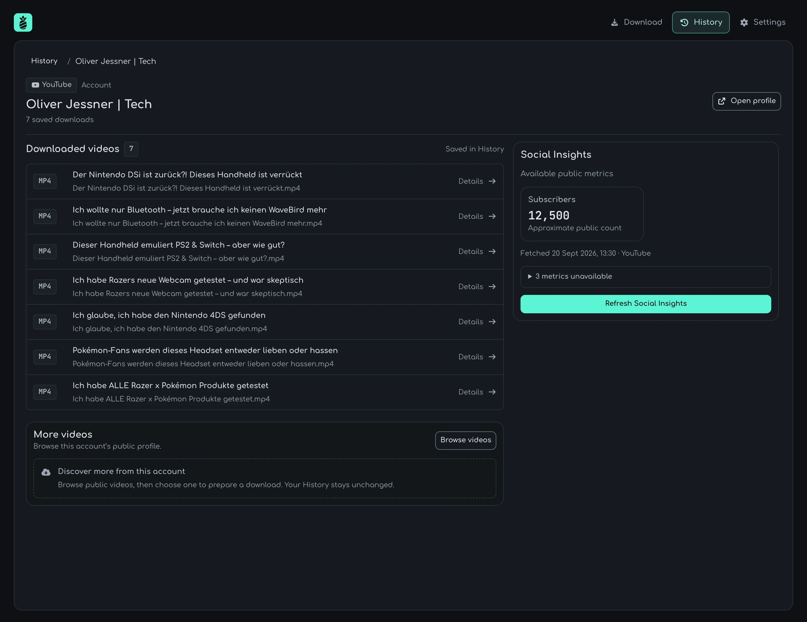
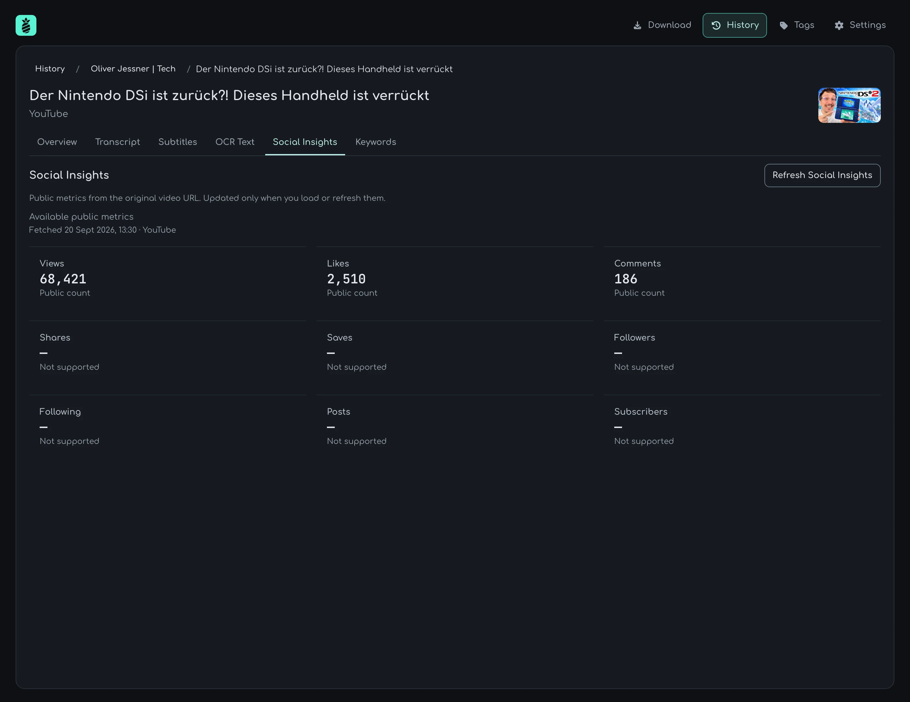
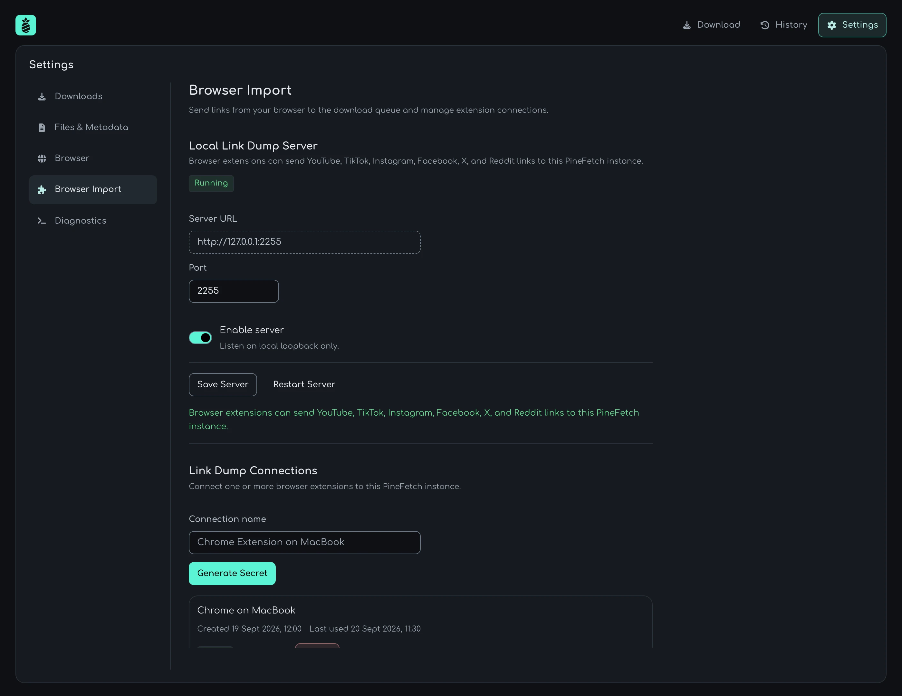

<p align="center">
  
</p>

# PineFetch 🍍

[](https://github.com/oliverjessner/PineFetch/actions/workflows/dependabot/dependabot-updates) [](https://github.com/oliverjessner/PineFetch/actions/workflows/quality.yml)

PineFetch is a desktop app for saving online videos, audio and text.<br>
It brings downloads, transcripts and searchable video text into one place.<br>
Your files and saved results stay on your computer.


Paste a link, choose a preset and a download folder, then start the queue. Add a YouTube playlist or import a TXT list when you have several links. Open a completed item in History to review its text, source details and saved files.

## What it does

- Download videos from YouTube, TikTok, Instagram and other supported platforms.
- Extract MP3 or Opus audio and create local transcripts with optional timestamps.
- Save available post captions and thumbnail images beside downloads.
- Queue individual links, YouTube playlists and TXT imports.
- Search saved downloads, transcripts and captions in History.
- Recognize on-screen text in videos and find recurring keywords in saved text.
- Browse creators' saved downloads and discover public profile videos.
- Load public video and account metrics on demand and keep snapshots for offline reference.

See the [video and caption compatibility list](docs/COMPATIBILITY.md) for accepted links and caption behavior.

## Install

Available for Apple silicon Macs running macOS 11 or later. Loading online Social Insights requires macOS 13.5 or later. Downloads require [yt-dlp](https://github.com/yt-dlp/yt-dlp#installation).

### Homebrew

```bash
brew tap oliverjessner/tap
brew install --cask oliverjessner/tap/pinefetch
brew install yt-dlp
```

### Download

Download the macOS DMG from the [latest release](https://github.com/oliverjessner/PineFetch/releases/latest), open it and drag PineFetch to Applications. Install yt-dlp separately if it is not already available.

On first launch, choose a download folder in the Download view. If yt-dlp is not detected, set its executable path in **Settings**.

To use your signed-in YouTube account, open **Browser Import → YouTube Cookie Sync**, select the browser where you are signed in, and click **Enable Cookie Sync**. Approve any browser-storage permission prompt to continue. PineFetch checks access without downloading a video and saves your selection after the check succeeds. yt-dlp then reads fresh cookies for YouTube downloads, playlists, and metadata requests. Use **Disconnect** to stop syncing. PineFetch stores only the browser selection; it does not export a cookie file. Cookies do not guarantee avoiding rate limits.

## CLI

Manage the download queue, list recent downloads and view statistics from your terminal.

```bash
/Applications/PineFetch.app/Contents/MacOS/PineFetch stats
```

See the [CLI documentation](docs/CLI.md) for all commands and options.

## Video, audio and local transcripts

Choose the best available video, video up to 1080p, MP3, Opus or a transcript with optional timestamps. Adjust transcription quality in Settings, keep the video alongside its transcript and optionally save post captions and thumbnails.



## Queue, history and batch imports

Add individual links, paste a YouTube playlist or import a TXT list of supported links, then let the queue run or pause after the current item. History keeps completed downloads searchable and shows recorded file sizes, runtime and totals by platform.



## Saved metadata, transcripts and captions

Open a History item to inspect its source, creator, file details, transcript and available captions. Search or copy saved text, open the downloaded file or return to the original page.



## Find text inside video frames

Run local OCR on a saved video to search recognized text and preview the frame where it appears. Copy all detected text, remove repeated results or delete individual frame text; [OCR details](docs/OCR.md) explain video requirements and controls.



## Find recurring keywords

Compare word counts across a video's saved transcript, OCR text and captions. Search terms, filter by source and see which words occur at least five times in total with [Keywords](docs/KEYWORDS.md).



## Browse videos by creator

Open a creator from History to see that account's saved downloads and browse publicly accessible profile videos. Choose a public video to prepare another download; see the [account guide](docs/ACCOUNTS.md) for platform limits.



## Public Social Insights

Load available views, likes, comments and account metrics when you need them, then read the saved snapshot offline. Refreshes are manual and available metrics vary by platform, as described in the [Social Insights guide](docs/SOCIAL_INSIGHTS.md).



## Send links from your browser

Connect [PineFetch Link Dump](https://github.com/oliverjessner/PineFetch-Link-Dump) to send supported video links from your browser to the download queue. Enable the connection in **Browser Import** and generate a connection secret to pair the extension.



## Who it is for

- Journalists and researchers collecting video sources and searchable text.
- Content creators saving their own videos, audio and transcripts.
- People reviewing on-screen text and recurring terms across saved media.

## Changelog

See the [changelog](docs/changelog.md) for release notes and changes.

## License

MIT
